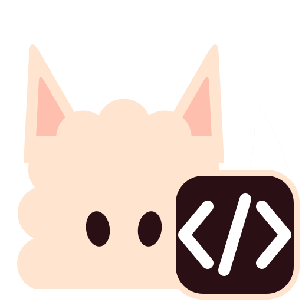
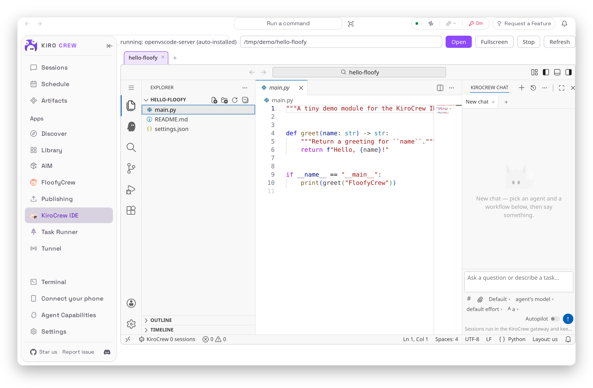
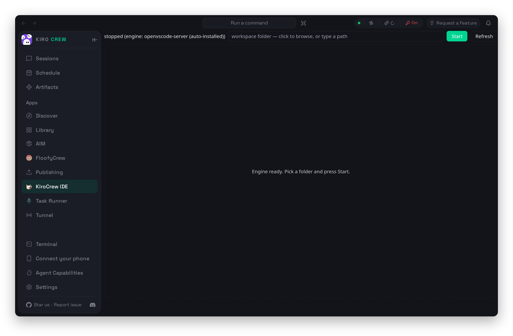

<a id="readme-top"></a>

<div align="center">
  <a href="https://github.com/floofycrew/kirocrew-ide">
    
  </a>
  <h1><b>KiroCrew IDE</b></h1>
  <p>
    A full VS Code workbench inside your <a href="https://github.com/kirodotdev/KiroCrew">KiroCrew</a> dashboard &mdash; with KiroCrew chat, durable sessions and the Kiro spec workflow in the editor. One port, no extra tunnel.
  </p>
  <p>
    <a href="https://github.com/floofycrew/kirocrew-ide/issues/new?labels=bug">Report a bug</a>
    &middot;
    <a href="https://github.com/floofycrew/kirocrew-ide/issues/new?labels=enhancement">Request a feature</a>
    &middot;
    <a href="https://github.com/floofycrew/FloofyCrew">FloofyCrew, the mod manager</a>
  </p>
  <p>
    <a href="https://github.com/floofycrew/kirocrew-ide/releases/latest"></a>
    <a href="https://github.com/floofycrew/kirocrew-ide/blob/main/LICENSE"></a>
    <a href="https://github.com/floofycrew/kirocrew-ide/stargazers"></a>
    <a href="https://github.com/floofycrew/kirocrew-ide/issues"></a>
  </p>
  <br>
  
</div>

<br>

<details>
  <summary><b>Table of contents</b></summary>
  <ol>
    <li><a href="#what-is-it">What is it?</a></li>
    <li><a href="#why-use-it">Why use it?</a></li>
    <li><a href="#install">Install</a></li>
    <li><a href="#a-tour">A tour</a></li>
    <li><a href="#everything-it-does">Everything it does</a></li>
    <li><a href="#parts">Parts</a></li>
    <li><a href="#requirements">Requirements</a></li>
    <li><a href="#install--develop">Install / develop</a></li>
    <li><a href="#config-keys-mod-config">Config keys</a></li>
    <li><a href="#one-port-only-remote-hosts">One port only</a></li>
    <li><a href="#tests">Tests</a></li>
    <li><a href="#license">License</a></li>
  </ol>
</details>

## What is it?

KiroCrew IDE is a [FloofyCrew](https://github.com/floofycrew/FloofyCrew) mod
that turns KiroCrew into your main IDE. It runs a VS Code web engine
(openvscode-server) as a loopback sidecar of the KiroCrew gateway, serves the
whole workbench **inside the dashboard, on the dashboard's own port**, and puts
KiroCrew into the workbench: chat with any crew agent, sessions that survive a
dropped ssh connection, tool approvals from the editor, and the Kiro spec
workflow (requirements &rarr; design &rarr; tasks &rarr; **Run all tasks**) over
`.kiro/specs`.

## Why use it?

- **One port** &mdash; the workbench is served same-origin at `/kirocrew-ide`;
  the port you already forward carries the IDE, nothing extra to tunnel.
- **KiroCrew inside** &mdash; chat tabs, per-project history, approvals and
  question cards in the editor; sessions run in the gateway, so closing the
  laptop loses nothing.
- **Kiro's spec workflow** &mdash; Specs, Steering, Skills and Agent Hooks views,
  **Run all tasks** on a `tasks.md`, a completeness donut per workspace.
- **Several workspaces, one engine** &mdash; a tab row like a browser's; idle
  workspaces sleep and wake in seconds.

Unofficial. Not affiliated with Kiro or the KiroCrew maintainers.

## Install

Needs [FloofyCrew](https://github.com/floofycrew/FloofyCrew) on the gateway
host. Then:

```bash
floofy install kirocrew-ide
```

or click *Install* on the dashboard's **FloofyCrew** page, restart the gateway
once (the same-origin route is added while it composes its router; the
FloofyCrew page has the button), and open **Apps &rarr; KiroCrew IDE**: pick a
folder, press **Start**. The first start offers to download the engine
(openvscode-server, MIT, ~100 MB) after your confirmation; an
`openvscode-server` or `code-server` already on PATH is used instead.

<div align="right">[<a href="#readme-top">back to top</a>]</div>

---

## A tour

**The App page** is where a workspace starts: a folder picker with recent
workspaces, Start/Stop, engine install, and the workbench docked right there
while the engine runs. **Fullscreen** raises it over the whole dashboard.

<div align="center">
  
</div>

**The workbench** is VS Code with KiroCrew in the secondary side bar: one
session per chat tab, every installed agent in the picker, approvals inline,
file paths as links into editor tabs. Out of the box the workbench follows the
dashboard's light or dark mode with the matching stock VS Code theme; pick any
other theme and it stays yours.

<div align="right">[<a href="#readme-top">back to top</a>]</div>

---

## Everything it does

- **KiroCrew IDE** in the Apps sidebar: a folder picker (recent workspaces +
  browse; its list opens over the docked workbench, not under it), Start/Stop,
  engine install, and the workbench **docked in the
  page** while the engine runs, with a **Fullscreen** button that raises it
  over the whole dashboard (not the OS fullscreen). It is one persistent
  layer either way: it stays warm while hidden or docked, so going back to
  KiroCrew, leaving the page and returning never reloads it. A bouncing
  FloofyCrew fox covers the workbench while it boots; the empty-editor
  watermark is the fox in grey.
- **Tag stacks** to move without leaving the IDE: in KiroCrew's own crew
  switcher the host's chip grows an attached **`IDE`** segment
  (`[host]IDE]`) while the IDE runs there, lit while it is fullscreen. The
  layer's title bar has ◁ KiroCrew, a host dropdown (the crew on screen as the
  trigger; the menu lists Local and every remote the desktop app knows, the
  current host marked "you are here" and returning to its dashboard, the
  others switching hosts through the desktop window exactly as KiroCrew's own
  bar does; colours follow the workbench's menu theme) with the same lit
  `IDE` segment joined to it (`[host ▾]IDE · folder ▾]`). Esc closes a menu,
  then leaves fullscreen like ◁ KiroCrew does — onto the App page's dock when
  that page is open, otherwise back to the dashboard. In a plain browser tab
  without a crew bar a standalone
  `<host> IDE` chip sits in the top bar.
- **Several workspaces on one host.** The `IDE` segment is a dropdown — the
  workspace manager: every folder open on the engine (the one on screen
  marked, a × to close it) and **Open a folder…**, which opens **KiroCrew's
  own folder picker** (the Recent / Browse picker the chat composer and the
  Spec Builder use, fed by the dashboard's recent-projects and browse APIs),
  anchored under the tag and painted over the fullscreen IDE, so another
  project opens without leaving fullscreen. The App page's folder field opens
  the same picker. The dashboard does not export that component, so the mod
  reaches it through the chunk the dashboard preloads (`spa/hostpicker.mjs`,
  no build hash hardcoded); a dashboard without it gets the mod's own
  combobox (recent workspaces, then the engine-side directory listing). The picker's box is
  raised above the fullscreen IDE by a rule keyed on its own `pp-…` element ids on *any*
  of its tabs; until 0.30.7 the rule named the Recent and Browse lists only, and KiroCrew
  0.11's picker, which opens on a Favorites tab when favourites exist, flashed for its
  first paint and then vanished behind the IDE. One engine serves them all; each
  workspace is its own workbench document, created when first shown and kept
  warm, so switching never reloads anything. The App page mirrors this: Start
  reads **Open** while the engine runs and adds the folder, and a tab row sits
  on the workbench like a browser's (click to switch, × to close, **+** opens
  the folder picker). Closing the last one leaves the engine up with nothing
  open. Each warm workspace is a live workbench: on the client it is a full
  VS Code renderer (roughly 300–450 MB of browser memory each), and on the
  host it is its own extension host, file watcher and language servers
  (150–400 MB each, growing with the extensions a folder activates). So
  **inactive workspaces sleep**: a document that has been off screen (another
  workspace in front, or the IDE left for other dashboard pages) for 15
  minutes is unloaded, which frees both sides within a second. The workspace
  stays open; its tab shows ☾ and the menu row reads *asleep*; switching to
  it reconnects in a few seconds, with the workbench's own hot exit and
  terminal persistence covering the gap. The limit is the **Sleep inactive
  workspaces after** select at the bottom of the workspace menu (never, 5,
  15, 30, 60 min), a host-wide setting (`idle_unload_minutes`). A freshly
  created document (first show, or a wake) that has not connected to the
  engine within 20 s is reloaded once by the layer: the host counts the
  WebSocket bridges that reached the engine (`status.proxy.websockets`), and
  a document whose budget passes with that count unchanged is the blank page
  the desktop client could show after a wake. One reload, never a loop; a
  second miss is left to the workbench's own connection-error dialog.
- **Task completeness per workspace.** A tiny donut and percentage sit at
  the workbench's top right, just left of its own layout controls (measured
  from the live title bar so they never overlap), in docked and fullscreen
  mode alike: the share of ticked boxes in the workspace's
  `.kiro/specs/*/tasks.md` files, every box counted (parent and sub-task,
  optional `*` ones too), the done share in the theme's chart green and the
  queued / in-progress share Kiro's orchestrator writes (`[~]` / `[-]`) in
  its chart blue. Several specs combine into the one figure; click it for
  the breakdown: the combined count, then a row per spec directory with its
  own donut, `done/total` and the live states. The workspace menu's rows and
  the App page's tabs carry the same mini donut per workspace, so every open
  folder's progress is one glance away. The hook counts the files on each
  status poll (re-read only when a file changes), so a tick the agent writes
  shows within seconds. Nothing is shown for a folder without spec tasks.
- **The bar keeps out of the workbench's way.** In fullscreen the layer's bar
  (`◁ KiroCrew | host ▾ | IDE · folder ▾`) ends where the workbench's own
  title-bar centre (the ← → arrows and the command centre) begins, measured
  from the live document and re-measured on resize. The command centre itself
  is served at half its stock width (`command_center_scale`, default `0.5`):
  the stock 38vw / 600px pill shows only "Search <folder>" and took most of
  the title bar once docked in the dashboard. Under that budget the
  folder name is the piece that gives way: it is not ellipsised but faded at
  the cut edge, like KiroCrew's crew row. Rest the pointer on the chip and
  the name glides to its end (and back when you leave); a wheel or trackpad
  anywhere on the chip scrolls it by hand; the full path is in the tooltip
  and the menu. The bar's text colours are derived for readability rather
  than copied from the theme: the command-centre foreground is used only
  when it reaches 3:1 on the pill, else black or white by luminance; the
  accent for the lit `IDE` word and the count badge keep their theme colour
  only when it reads, so a light theme with a pale foreground (Tempest) no
  longer paints the folder name in near-invisible grey.
- **Profiles follow you.** The web workbench keeps the profile list in the
  browser, per origin, so a profile imported in the desktop app used to be
  missing in a browser tab (or after the app's storage moved) while its data
  sat on the host. The mod now seeds every client's list from the engine's
  own record of the profiles that exist on disk. The Profiles editor's **Use
  for New Windows** choice is honoured too: a folder opened from the mod with
  no profile of its own boots into that profile (the web workbench alone only
  reads the URL and the folder's association, never that setting; the mod reads
  it from the browser's user-data store and rewrites the URL before the
  workbench starts, with one early reload the first time after you toggle it).
  A profile you picked for a folder with *Switch Profile* still wins — and
  that choice follows you too. The web workbench keeps *which profile a folder
  opens in* in the browser as well, and never tells the server (the engine's
  mirror of it is always empty), so a folder you had given a profile in the
  desktop app used to open in Default from a browser tab. The layer, which
  shares the dashboard origin with every workbench document, now reports the
  browser's folder → profile map to the host (once at start, and after every
  change a workbench makes to it), the host keeps it by folder path, and every
  served document seeds the record into the browser before the workbench boots
  — only for folders that browser has no entry of its own for, so a choice
  made in this browser (switching a folder back to Default included) is never
  overwritten. The same seed heals a second, quieter loss: the workbench keys
  those entries by the engine's `127.0.0.1:<port>`, so a relaunch that landed
  on the next free port orphaned every earlier choice; an entry held under an
  old port is copied to the current one. **A relaunch now keeps its port.** Until
  0.30.4 every relaunch (each new bridge version relaunches) flipped the engine
  between 35476 and 35477: the stop watched the `sh` wrapper's pid, which dies
  at once, while `node` was still closing the listener, so the port read busy
  250 ms later and the next one was taken. The workbench writes
  `__default__profile__` itself the first time a folder boots with no entry
  under the current port, and that stale Default came back on every other
  relaunch, so a folder given a profile on one port opened in Default on the
  other (2026-11-05). The stop now waits for the port to be released and the
  relaunch takes it again (the probe binds with `SO_REUSEADDR`, like node, so
  TIME_WAIT leftovers do not count). The seed also repairs the damage already
  in a browser's map: a Default under the current port gives way to a real
  profile the same browser holds under an earlier port, and once a folder has
  its entry under the workbench's own authority the copies under earlier ports
  are dropped, so they cannot come back. (A Default you chose on purpose for a
  folder that still has an old-port entry is undone once by that repair; pick
  it again and it stays, there is no old entry left to fight it.) **A Default
  is never a choice.** The web workbench writes the profile it booted into for
  the folder on *every* boot (`web.main`'s `setProfileForWorkspace` right
  after picking it), so a folder's first boot in any browser, or under any
  engine port, leaves `__default__profile__` behind, indistinguishable from a
  user switching to Default. Until 0.30.5 the host recorded those, the seed
  copied them into every other browser, and a Default association switched the
  folder off "Use for New Windows" for good: one new client booting a folder
  put every other client into Default on its next reload. Now a Default is
  never recorded, shipped or copied (stale ones in the host record are purged
  on the next write), and "Use for New Windows" applies to a folder whose only
  association is a Default. The one casualty: a folder you switched back to
  Default on purpose boots into the new-window profile again while that setting
  names one; clear the setting to keep a folder in Default. **Two faults fixed in
  0.30.6, both found live in a user's browser.** The profile-list seed copied
  the server's records with the server's `location` shape (a bare id); the
  browser service stores a URI object and its loader aborts the whole list at
  the first string, so a browser whose list the seed had filled saw *no*
  profiles at all: an empty picker, every folder in Default, and the list
  rewritten to `[]` on the next save ("my profile disappeared"). The seed now
  writes `{"$mid":1,"scheme":"vscode-userdata","path":"/User/profiles/<id>"}`
  and repairs entries an earlier seed stored. And the association seed keyed
  entries by the configuration meta's `remoteAuthority` (the engine's own
  `127.0.0.1:<port>`, since the proxy drops the browser's Host) while the
  workbench keys them by the page's `location.host` (openvscode's
  `workbench.ts`); from 0.30.4 that seed moved every real entry to the dead
  authority and pruned it, so a folder switched to a profile booted into
  Default on the next reload. The seed now keys by `location.host`, repairs
  the dead-authority copies back, and a real profile (this browser's own or
  the host record's) replaces a Default under the live key, a Default being
  never a choice. The one shape of Default that *is* a choice, a switch in a
  live document (real → Default), is reported by the layer as `cleared` and
  removed from the host record, so it is not brought back. The host pins the
  record by the dashboard host the browser reported from (its `Host` header).
- **KiroCrew Chat** in the IDE's secondary side bar (the built-in AI chat is
  turned off): tabs, one KiroCrew session per tab, per-project **History**
  (every session whose project is the open folder — created here or in the
  dashboard — reopens in a tab; most recent activity first, each row dated
  by its age), any installed agent, live streaming, paths
  as links into editor tabs, Approve/Reject and question cards inline. A chat
  pane that comes up blank is reloaded by the bridge itself (twice, 8 s apart)
  before it tells you; **KiroCrew: Reload chat view** (also in the view's ⋯
  menu) does the same by hand, and the **KiroCrew IDE** output channel says
  what happened. The composer's model/effort/Autopilot picks are yours alone:
  what a live session actually runs with is shown on its tab but never
  inherited by the next tab, and a model id the host's catalog has retired is
  dropped (with a note) instead of pinned on a new session. The tab that was in
  front is remembered with the tabs: a reopened window comes back on it (until
  0.30.8 it always opened the first, oldest tab); a record without that memory
  opens on the newest chat.
- **Steering, Kiro's way.** Every chat started here runs on kiro-cli with the
  open folder as its working directory, so the workspace's `.kiro/steering`
  and `~/.kiro/steering` load exactly as Kiro CLI loads them: a file with no
  front matter or `inclusion: always` is in every turn, while `fileMatch` and
  `manual` files are left out by the agent itself (verified against kiro-cli
  2.33). Subdirectories count: the agent's `steering/**/*.md` resource walks
  them (verified on kiro-cli 2.34, `steering/a/b/c.md` loads like
  `steering/c.md`), and the bridge's own inventory walks them too, naming a
  nested file by its path under the steering dir (`#amazon-builder/git`, or
  the bare `#git` when no other file has that name). Who loads the `always`
  tier depends on the host's agent engine, so the receipt says which: on KAS
  (`acp_backend: kas`, the default) both tiers load for **every** agent, Kiro's
  built-in Spec mode included, whatever the agent's `resources` say (verified on
  kiro-cli 2.34 `--v3`: an agent with no `resources` key and one whose
  `resources` omit steering both got the files, `manual` ones excluded); on the
  legacy engine steering comes only through the agent's `resources`, and the
  receipt warns when they leave it out. A Spec tab whose mode agent the host
  refuses re-posts the receipt for the agent it falls back to. The bridge adds the other two modes the way Kiro's IDE does
  ([inclusion modes](https://kiro.dev/docs/steering/)): a `fileMatch` file
  whose `fileMatchPattern` matches a file in the turn's context (a `#` file or
  open-files pick, the editors on screen) and a `manual` or `auto` file the
  message names with `#file-name` ride along as context, each shown as a
  `#steering: name` chip on the turn. A compass indicator in the composer
  counts the always-included files and lists every steering file with its
  mode (click a manual one to include it now, an always one to open it); a
  session's first turn prints a *Steered by …* receipt naming the always files
  per tier, and warns when the chosen agent's `resources` leave steering out.
- **The input box is yours to size.** It grows with what you type (to about
  45% of the pane); drag the grip on its top edge for a height of your own,
  remembered per workspace; double-click the grip to go back to automatic.
- **Your turn shows the instant you send it.** The page draws your bubble
  (text, `#` chips, image thumbnails) and starts the working foxes on Enter,
  before the extension has created the session, applied your picks, uploaded
  the files, scanned steering and injected the contexts; the extension's own
  copy of the turn then completes that bubble in place (the uploaded paths,
  for the lightbox's Open file) rather than adding a second one. If the send
  fails, the error lands under the bubble and the pane is released. The
  steering inventory, read on every send through the remote fs, is cached for
  20 s and dropped the moment a steering file changes.
- **Pictures in the chat.** An image pasted into the composer, picked with 📎
  or dropped onto the composer shows as a thumbnail in the chip row (× to
  remove, click to preview) before it is sent; in your bubble it is the picture
  itself, with any other file as a 📎 chip that opens it. A transcript loaded
  from history shows the same: the `[attached_file N]` markers are resolved
  against the row's file list (a path with a space survives) and each image is
  fetched through the extension, since the page cannot read the disk and the
  dashboard keeps uploads outside the workspace (`~/.kiro/crew/uploads/`). A
  markdown image in an answer (``, an https URL
  too) is drawn in place instead of linking to the file. Every picture opens a
  lightbox on click (full size, the file name, **Open file** for an editor tab,
  Esc to close). Images over 8 MB are not previewed: the card names the file and
  opens it; a missing file is an error note with the path as a link. Fetched
  images are cached per path for the window.
- **Scroll up to read; jump back when you want.** The transcript follows new
  rows only while it is at the bottom (within 8px, the dashboard's rule).
  Scrolled up, streaming text and new rows land without moving the view, and a
  **Jump to latest** pill appears over the pane's bottom edge; it reads **New
  messages** and takes the accent colour once something arrived unseen. A click
  scrolls to the end (smoothly, instantly under reduced motion) and following
  resumes; scrolling back down by hand does the same. Your own turn and a
  reload always land at the bottom. The pill is the active tab's: each tab
  keeps its own position.
- **A reading column in a wide pane.** The transcript, the pinned prompt and
  the composer sit in a centred column, with the dashboard's three Chat
  settings presets (`kirocrew.chatWidth`): **compact** (default) is an 800px
  column (816px for the composer) scaled by the message font size, so no line
  runs the width of a 1400px panel; **comfortable** is 84% of the pane, **full**
  92%. A pane narrower than the column is unaffected (its 8px gutters stay).
- **KiroCrew** activity-bar views: *Specs* (`.kiro/specs/<name>/`, phase
  commands, ▶ Start task per row, ⏵⏵ Run all tasks per spec, ⟳ Resume run on a
  spec whose tasks.md still carries a run's `[~]` / `[-]` marks, Kiro's queued /
  in-progress / done marks), *Steering*, *Skills*, *Agent Hooks* — each showing
  the workspace's `.kiro/` and the global `~/.kiro/` tier, with a ＋ that
  scaffolds a new file or skill folder. The bridge is registered for **every
  VS Code profile** (application-scoped), so a profile you create or import
  keeps the chat and these views, and its activity bar gets KiroCrew in
  second place too.
- The model's reasoning renders the way KiroCrew's own transcript renders it:
  one collapsed **Thinking** block per thinking phase with a one-line live
  tail while it streams, **Thought process** once it goes quiet, the full text
  a click away; a tool call or the answer closes the block and later reasoning
  opens a new one.
- The transcript takes KiroCrew's own shape: your turn is a fit-width bubble
  on the right (small radius, the workbench's input colours), the agent's
  answer is bare text, tool lines are quiet mono rows, code blocks have the
  dashboard's padding and a hairline. **Your last prompt stays in view:** once
  the transcript scrolls past a user turn, that turn is pinned at the top right
  as a one-line card in the bubble's colours (KiroCrew's pinned prompt): three
  lines on hover, the whole prompt on its ⌄, and a click on the text scrolls
  back to where the turn starts. The card slides away as the next turn reaches
  it and that turn takes its place. **Tool calls open on click:** a 🔧 row's
  header toggles a body with the call's Input (a shell call shows its command,
  a one-field call its value, anything else pretty JSON) and Output (the
  result once the tool returned; a pulsing dot and "running…" until then),
  paths linked into editor tabs, both clipped at 20 KB with a marker. While the agent works and no answer is
  streaming yet (reasoning, tool calls, the wait for the first token) four
  small FloofyCrew foxes hop in turn under the last row, where KiroCrew shows
  its ghosts; they go still under *prefers-reduced-motion*.
- **The host's own notices are cards, not prose.** KiroCrew writes what it did
  to a turn as `inject` rows: a tool call its safety policy stopped (`[Tool
  blocked — reason sent to the agent] policy …`), a turn it resumed after a
  dropped connection or a stall, a Continue you asked for, a sub-agent
  synthesis. The IDE folds each into the dashboard's collapsed recovery card —
  a one-line header with the dashboard's own title and detail ("Tool call
  blocked · safety policy blocked the call · the agent was told why, in this
  turn"), the matched policy pattern as a mono chip (or "N patterns"), the
  whole notice under it on click, paths in it as links. Blocked, refused and
  stalled kinds carry the warning icon; resumed turns, a Continue and a
  synthesis are routine. A gateway notice with no known prefix is a generic
  "System notice" card; an automation notice draws nothing; cron notifications
  stay the quiet row they were.
- **Kiro's `task_status` rows say what they are.** Every status change the
  task orchestrator writes into `tasks.md` (`[~]` queued, `[-]` in progress,
  `[x]` done) is announced as a `task_status` action with no input, no output
  and no title; kiro-cli relays it as a completed tool call and KiroCrew
  persists it as such (one spec run had 410 of them among 698 tool rows). The
  only trace of *which* task is the action id (`…_taskStatus_1_1_Create__conne`:
  the task's line sanitized, capped at 64 chars), so the row reads "Task
  status · 1.1 Create conne…" with a 📋, and opening it shows a note saying what
  the row is instead of "(no output)".
- Attachments travel exactly as the dashboard composer sends them: each file
  is uploaded to the host and referenced by an `[attached_file N] <path>`
  marker with the path list in the send's `meta.files`, so the host inlines an
  image as a real image block, leaves other files on disk for the agent's
  tools, and its own transcript shows the same attachment cards for a session
  started here. (Earlier builds pasted `Attached file: <path>` prose, a shape
  the host never writes itself.)
- Sessions run in the gateway. Close the laptop, drop the tunnel, come back
  from the dashboard or your phone: same session, same transcript.

## Parts

| Part | Seam | What |
|---|---|---|
| `hook/` (python-hook, early) | gateway | engine supervisor + control API (`status` with per-workspace spec-task counts and engine health, `start` `stop` `relaunch` `workspaces/open` `workspaces/close` `engines` `engines/install` `extensions/install` `browse`), the same-origin proxy at `/kirocrew-ide`, bridge-extension provisioning |
| `app/` (app) | App Kit | the **KiroCrew IDE** App page. `app/ui/art/icon.svg` is the App's face in the Apps sidebar and the store (manifest `iconPath`): the fox wearing a `</>` badge |
| `extension/` | the engine | the KiroCrew web extension (chat, sessions, approvals, specs), provisioned per start |
| `preview/` | the engine | the spec-preview extension (engine-side host): a markdown-it plugin + styles for the built-in Markdown preview (Kiro task rows, spec header) and the mermaid preview script; provisioned per start beside the bridge |
| `ui/page.mjs` (ui) | FloofyCrew App | engine status and settings; points at the App. `ui/icon.svg` is the mod's face in FloofyCrew's Mod pages and Installed mods (the same fox as the App page's loading splash) |

## Requirements

An IDE engine on the gateway host (not bundled — your choice, your license).
With none found, the App offers **Install engine**: it downloads an
openvscode-server release (MIT, ~100 MB) from GitHub into the mod's data
directory after your confirmation — the mod's only network use
(`network.hosts`: github.com, api.github.com, objects.githubusercontent.com).
Alternatives: `openvscode-server` or `code-server` on PATH, or
`engine.command` in the mod config.

**Extensions.** The engine's store is [Open VSX](https://open-vsx.org), where
many Marketplace extensions were never published (the Microsoft Marketplace
serves only Microsoft's own builds). So the Extensions view searches **both
stores at once**: the mod runs a small merged gallery on the host's loopback
(both stores speak the same gallery protocol; each query fans out to Open VSX
and the Marketplace, results are interleaved by each store's own rank with
duplicates collapsed to the Marketplace copy). Two clients are pointed at it,
because they read different things: the engine's `product.json` (the server's
own gallery client, used for installs and update downloads; original kept
beside for restore) and the **workbench page** the proxy serves, whose
`productConfiguration` the hook fills in — the Extensions view searches from
the browser, with a product configuration baked into the web bundle (Open
VSX) that openvscode-server 1.109 never overrides from `product.json` (it
serves that object empty). The browser tries the loopback URL itself, fails
(it is the gateway's loopback, not yours) and forwards the request over the
workbench connection to the engine, which reaches it; the view's other
gallery routes (`…/latest` per installed extension, install stats) are served
too. Install, update and readme assets come from whichever store an entry
came from; a store that is down just drops out of the merge. `engine.gallery`
in the mod config: `merged` (default), `openvsx` (the engine's own store,
product.json restored) or `marketplace`. The gallery is per gateway process
and listens on `127.0.0.1` only, on a stable port (first free of 35486–35495,
or `engine.gallery_port`), closed and rebound on a mod reload; `open-vsx.org`
joins the declared hosts. `status.gallery.recent` lists the last requests it
answered (a query with its text and hit count), so an empty search is a
one-line diagnosis: no entry means the view never reached the gallery. For a
link you already have, the Extensions view title also has **Install from
Marketplace link…** (and the command palette): paste the
`marketplace.visualstudio.com/items?itemName=publisher.name` link (or just
`publisher.name`), and the hook downloads that extension's VSIX and installs
it with the engine's own CLI, with a **Reload Window** button when done.
`marketplace.visualstudio.com` is a declared host. Extensions
that hard-depend on Microsoft-proprietary services (Pylance, C# Dev Kit, Live
Share, Remote) do not work in a non-Microsoft build whichever way they are
installed.

The engine binds `127.0.0.1` only and, by default, runs without a connection
token (see `engine.token`); the dashboard's own session is what guards the
proxy.

**Kiro's own modes** (Spec, Quick Spec, Bug Fix, Plan as real agents) come
from the **kiro-spec-plan** mod, which this mod *recommends* rather than
requires: `floofy install kiro-spec-plan` (or the FloofyCrew page) adds its
four agents to `~/.kiro/agents`, and the chat's Agent picker then lists them
under "Kiro modes". Without it the same four names appear under "Workflows
(prompt-guided)" — a prompt frame injected on your default agent, not Kiro's
procedure — headed by a row that says so and hands you the install command.

Hosts from KiroCrew 0.8.0.9 on reserve KAS's bundled mode ids (`spec`,
`quick-spec`, `bug-fix`, `plan`, …) and refuse a session whose agent carries one
("Rename this crewmate's template: 'spec' is reserved for a built-in agent …"),
which is exactly the name kiro-spec-plan's handles use. The bridge catches that
refusal on the first send, says so once in the transcript, and re-sends the
turn as the prompt-guided workflow on your picked agent, skipping the doomed
attempt for the rest of the window. KiroCrew 0.11 wears the same refusal
differently: it renames a reserved id on the wire (`spec` registers as
`spec-crewmate`) and, when nothing registers under that alias, fails the start
with "Agent mode 'spec' is not available on this session (advertised modes:
[… 'spec' …]); its ~/.kiro/agents/spec.json is likely missing" (the file is
there; the id it looked for was the alias). The bridge treats that sentence,
for the four mode ids only, as the same refusal. **kiro-spec-plan 0.2.2** pins
the mode ids to the bundled ids on that host, so with it installed Kiro's
real Spec mode runs and neither fallback is needed.

**Running tasks** works the way Kiro's IDE does. On a `tasks.md` the
editor's primary action is **Run all tasks** (or **Resume tasks** once some
are ticked): one click, one durable session, every remaining required task
back to back — no "run task N" per task. Each open row has its own **Start
task** for a single task; queued (`[~]`) and in-progress (`[-]`) rows show
their state instead. Both run with Autopilot on (`kirocrew.specAutopilot`),
as Kiro does, so the run is not interrupted by tool approvals. With
kiro-spec-plan installed the request sent is the very text Kiro's IDE sends
its engine ("Run all tasks for this spec." with the resume suffix; "Execute
the following task …" with Kiro's `<task>` block), so the engine's own Task
Orchestrator queues the tasks, runs them through its task-execution sub-agent
and writes `[~]` / `[-]` / `[x]` back into `tasks.md` as it goes. Without it a
paraphrase carrying the same task block asks your crew agent for the same
non-stop loop. Optional tasks (`- [ ]* …`) are skipped by Run all; the spec's
context menu has **Run all required and optional tasks**, which removes the
`*` marks first (Kiro's "make all required").

**An interrupted run resumes itself.** A long Run all tasks gets cut: by the
host's turn limit (`agent.chat_turn_timeout_secs`, 4 hours by default, 24 at
most, in `~/.kiro/crew/config.json`: "⏱️ This turn hit the 4-hour limit and was
stopped …"), by a dropped connection, a backend error, a gateway restart, or a
model that simply ends its turn mid-list. The IDE does not key on the error
text for any of these. It judges the run from `tasks.md`: Kiro's orchestrator
writes `[~]` (queued) and `[-]` (in progress) as it goes and leaves neither
behind when it finishes, so a turn that ends with either still in the file did
not finish the run (for a run this IDE dispatched, open required rows count
too). A moment after each turn ends, with the session idle, the bridge
re-reads `tasks.md` and, if work is left, sends the run's own request again
(Kiro's "Run all tasks for this spec." with the ticked tasks to skip, or the
single task's request; a note asks the engine to check a `[-]` row before
trusting it), up to `kirocrew.specResumeLimit` times per run (default 3, so a
run can span four turns), each resume announced with its cause ("The host
stopped this turn at its 4-hour limit", "The turn ended on an error (…)",
"The turn ended with 1 task in progress and 10 queued, without finishing the
run"). It holds back, and shows a card with a **Resume run** button instead,
when you pressed Stop, when a question card is waiting, when the answer
ended on a question (an `[OPTIONS:` line or a trailing "?"), past the cap, with
`kirocrew.specAutoResume` off, and at startup (a reloaded window judges each
restored tab once and never sends on its own). A Spec tab with no run record
of its own (a tab from before 0.27, a run the dashboard started) adopts the
one spec whose `tasks.md` carries those marks. The ⏱ card keeps its red box
and **Continue from where it stopped** button for plain chats. Outside the
chat, the same run is one click away: the **Specs view** marks a spec with
marks left behind as *interrupted: 1 task in progress and 10 queued* with a
⟳ **Resume run** action, and the spec editor's primary action on such a
`tasks.md` reads **Resume run (N left)**; both resume in the session that ran
it when its tab is still open and idle (the orchestrator keeps its context),
and start a fresh Run all tasks otherwise. Nothing is sent while the session
is still running or when every task is already ticked.

**The spec editor's page** is rendered by the engine's own markdown renderer
(the built-in preview's markdown-it, through its `markdown.api.render`
command): GFM tables, the same highlight.js colouring on fenced code as the
built-in preview, one palette per theme kind. On top of that the page keeps
what the built-in preview does not have: a language label and **Copy** on
every code block, Kiro's task boxes and Start buttons, and `mermaid` fences
drawn in place (see *Mermaid* below). Relative links open against the spec's
own directory; relative images load from it. Should the markdown extension be
disabled, the mod's own renderer takes over, without the colouring.
**Shift+Cmd+V / Ctrl+Shift+V and Ctrl+K V on a spec file open the spec
editor** (beside the source for Ctrl+K V), and the title-bar preview button on
a spec file's source is the spec editor's; every other markdown file keeps the
built-in preview and its keys. **Edit source** in the banner (or *Reopen
Editor With → Text Editor*) is the way back to the text.

**Find in a spec document.** Ctrl+F (⌘F) in the spec editor, the 🔍 Find
button, or *KiroCrew Spec: Find in document* opens a find bar in the sticky
banner: every match is marked, the current one stronger and scrolled into
view, with "3 of 12", ↑ ↓ (Enter / Shift+Enter, F3), an **Aa** match-case
toggle and Esc to close. The search covers headings, text and code (not the
page's own labels or drawn diagrams), case-insensitive by default, and stays
live across a Sync Files or an edit on disk. On `tasks.md` a **Filter tasks**
toggle hides the task rows that do not match, keeping a matching task's
sub-tasks and a matching sub-task's parent, so a long plan reduces to the
tasks about one thing. The webview host swallows Ctrl+F before the browser
sees it and forwards the key to the workbench; the page opens the bar on its
own keydown and the extension's keybinding (while a spec editor is active)
sends the same request, so the shortcut works whichever way it arrives.
Matches are found within one run of text: a phrase split by inline markup
(`**bold** text`) is not matched across the split.

**Mermaid.** The engine has no renderer for ```` ```mermaid ```` fences, and
Kiro's `design.md` is full of them. The mod does not ship the library: the
first time an engine starts, the hook fetches one pinned build of mermaid
(`MERMAID_VERSION` in the hook, SHA-256 checked, 3.5 MB, from
`cdn.jsdelivr.net`) into `<data>/vendor/` and copies it into both provisioned
extensions as `media/mermaid.min.js`. The spec editor draws its fences with
it, and the **built-in markdown preview** of any file does too, through the
mod's second extension (`preview/`, see *Parts*): that extension also marks
Kiro's task rows in the built-in preview of a spec `tasks.md` (state boxes, the
optional tag, a progress strip) and puts a spec header on `requirements.md` /
`design.md` there. A diagram that does not parse keeps its source with the
parser's message under it. Offline, the start goes on without diagrams and the
fetch is retried at the next start; `status.mermaid` says which.
`mermaid.enabled: false` in the mod config turns all of it off.

## Install / develop

```bash
floofy install kirocrew-ide          # from the FloofyCrew registry, or the Install box on the FloofyCrew page
# restart the gateway once: the same-origin proxy is added while it composes its router
# then Apps -> KiroCrew IDE -> pick a folder -> Start
```

From a checkout of this repository, `floofy dev <checkout> --follow` runs the
mod live against your dashboard.

Design, the display-strategy analysis, the bridge architecture and the "why a
mod, not an App" proof: [DESIGN.md](DESIGN.md).

## Config keys (mod config)

| Key | Meaning |
|---|---|
| `default_folder` | folder the picker starts in / Start opens when none is given |
| `idle_unload_minutes` | minutes an off-screen workspace document stays warm before it is unloaded (default 15, `0` never); set from the workspace menu's footer, route `POST settings/idle-unload {"minutes"}` |
| `command_center_scale` | width of the title bar's command centre (the search pill) relative to the stock 38vw / 600px (default `0.5`, so half; `1` = stock width; floor 0.25). Served in the workbench page, so a reload applies it |
| `engine.heap_mb` | V8 heap ceiling (MB) handed to the engine and every extension host through `NODE_OPTIONS --max-old-space-size` (default 8192; `0` leaves node's own ~4 GB). A ceiling, not a reservation. |
| `engine.command` | full engine command template (`{port}` `{token}` `{folder}` `{auth}` `{basepath}` `{extensions}`) |
| `engine.version` | pin the auto-installed openvscode-server version (default: latest release) |
| `engine.port` | pin the engine's loopback port (default: first free of 35476–35485) |
| `engine.token` | `true` runs the engine with a connection token; breaks embedding (its cookie is `SameSite=Lax`) |
| `engine.gallery` | `merged` (default: Open VSX + Microsoft Marketplace in one Extensions view), `openvsx` (engine's own store), `marketplace` |
| `engine.gallery_port` | pin the merged gallery's loopback port (default: first free of 35486–35495) |
| `mermaid.enabled` | `false` skips the pinned mermaid download and leaves ```` ```mermaid ```` fences as code blocks everywhere (default `true`) |

IDE-side settings (VS Code settings, `kirocrew.*`): `agent` (default agent
for chats and spec phases), `specAgent` (agent that executes tasks),
`specAutopilot` (task runs approve their tools, default on), `specAutoResume`
and `specResumeLimit` (an interrupted task run resumes itself from tasks.md,
whatever cut it, default on, 3 times), `chatFontSize` and `chatWidth` (the
transcript's font size and reading column: `compact` | `comfortable` | `full`),
`folderName` (dashboard folder, default "KiroCrew IDE"), `notifyApprovals`.

## One port only (remote hosts)

The workbench is served same-origin at `/kirocrew-ide` on the dashboard, so the
port you already forward carries the IDE — nothing extra to tunnel. The route
is added while the gateway composes its router, hence the one restart after
installing. Should the early shim be unavailable, the mod falls back to the
engine's own loopback port and the App tells you the `ssh -L` line.

**A stuck engine.** An extension host that dies (on 2026-10-20 one reached
node's default heap limit and was SIGABRT'd) can leave the engine answering
HTTP while servicing no new workbench connection: `status.running` stays true,
the page loads and stays blank through every client reload. The hook now
watches for exactly that on the proxy's own WebSocket bridges: a workbench
connected 25 s ago, sent its frames, and the engine has answered nothing on
that bridge or any other since (a bridge the engine answers or closes itself
is a live engine; one the client never spoke on proves nothing). `status.health.stuck`
turns true, the layer replaces the bouncing fox with the reason and a
**Relaunch engine** button (the App page shows the same banner), and `POST
relaunch` stops and starts the engine with the same workspaces; every document
reconnects on its own. The heap ceiling (`engine.heap_mb`, 8 GB by default)
makes the death itself rarer.

The proxy's WebSocket bridge connects the engine side first and only then
accepts the browser's upgrade: an engine that refuses, is gone, or does not
answer within 10 s is a plain 502 before any upgrade, so the workbench shows
its connection error and retries instead of sitting on a blank page. Every
bridge's outcome is in `GET debug/proxylog` (`ws`, `ws-closed after Ns`,
`ws-upstream-failed: …`), and `status.proxy.websockets` carries the running
counts (`opened`, `failed`, `live`).

## Tests

```
python tests/<name>_test.py            # hook units (stub floofy module, no host code)
node --test tests/*.test.mjs
tests/e2e/probe_extension.py <url>     # headless: the extension activates in the workbench
tests/e2e/probe_profile.py <url> <profile> <udd>   # headless: bridge + seeded order in a non-default profile
tests/e2e/probe_hosts.py               # headless, self-contained: the layer (host switcher, modes, workspaces) in stub realms
tests/e2e/probe_chat_webview.py        # headless, self-contained: the chat webview's transcript (the thinking block) driven with the extension's own messages
tests/e2e/probe_gallery.py <url> <gallery> <text>   # headless: the Extensions view searches through the merged gallery (browser route aborted = remote browser; --direct keeps it)
tests/e2e/probe_spec_editor.py --engine <bin> [--mermaid <mermaid.min.js>]   # headless, scratch engine: the spec editor renders through the engine's renderer (hljs spans, code bars, task boxes, mermaid) Ctrl+Shift+V on a spec file opens it, and Ctrl+F through the workbench opens its find bar
tests/e2e/probe_spec_find.py           # headless, self-contained: the spec editor's find bar (marks, count, Enter/Shift+Enter, Aa, Filter tasks, refresh, Esc) driven with the keyboard
tests/e2e/chat_roundtrip.py <url>      # headless: a message round-trips through a gateway session
```

The e2e scripts drive a workbench URL; through the dashboard (with a session)
the chat round-trip is real, directly on the engine port only activation is.

## License

MIT. The IDE engine you install has its own license (openvscode-server: MIT;
code-server: MIT; Microsoft's VS Code builds/marketplace have their own terms
— this mod ships none of them).
