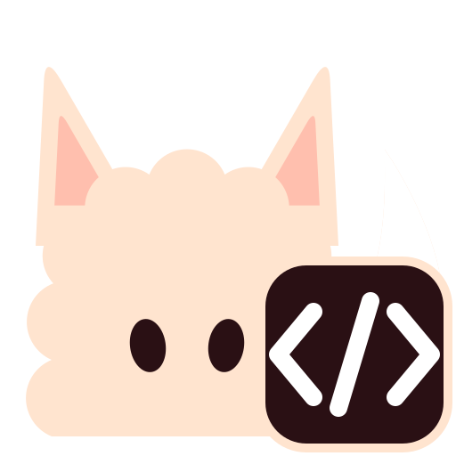
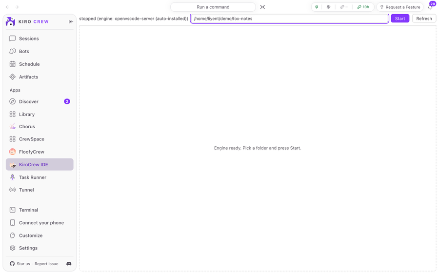
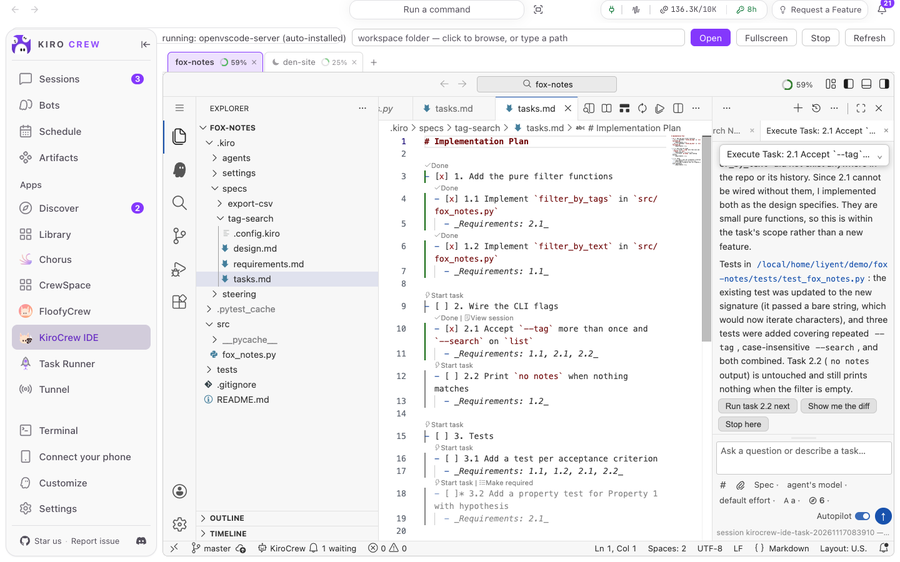

<a id="readme-top"></a>

<div align="center">
  <a href="https://github.com/floofycrew/kirocrew-ide">
    
  </a>
  <h1><b>KiroCrew IDE</b></h1>
  <p>
    A full VS Code workbench inside your <a href="https://github.com/kirodotdev/KiroCrew">KiroCrew</a> dashboard &mdash; with KiroCrew chat, durable sessions and the Kiro spec workflow in the editor. One port, no extra tunnel.
  </p>
  <p>
    <a href="https://github.com/floofycrew/kirocrew-ide/issues/new?labels=bug">Report a bug</a>
    &middot;
    <a href="https://github.com/floofycrew/kirocrew-ide/issues/new?labels=enhancement">Request a feature</a>
    &middot;
    <a href="https://github.com/floofycrew/FloofyCrew">FloofyCrew, the mod manager</a>
  </p>
  <p>
    <a href="https://github.com/floofycrew/kirocrew-ide/releases/latest"></a>
    <a href="https://github.com/floofycrew/kirocrew-ide/blob/main/LICENSE"></a>
    <a href="https://github.com/floofycrew/kirocrew-ide/stargazers"></a>
    <a href="https://github.com/floofycrew/kirocrew-ide/issues"></a>
  </p>
  <br>
  
</div>

<br>

## What is it?

KiroCrew IDE is a [FloofyCrew](https://github.com/floofycrew/FloofyCrew) mod
that turns KiroCrew into your IDE. It runs a VS Code web engine
(openvscode-server) next to the KiroCrew gateway, serves the workbench **inside
the dashboard on the dashboard's own port**, and puts KiroCrew into the
workbench: chat with any crew agent, sessions that survive a dropped ssh
connection, tool approvals from the editor, and the Kiro spec workflow
(requirements &rarr; design &rarr; tasks &rarr; **Run all tasks**) over
`.kiro/specs`.

Unofficial. Not affiliated with Kiro or the KiroCrew maintainers.

## Install

**1. Install FloofyCrew** on the host that runs your KiroCrew gateway (skip if
`floofy doctor` already works there):

```bash
curl -fsSL https://raw.githubusercontent.com/floofycrew/FloofyCrew/main/packaging/public/install.sh | sh
floofy doctor
```

The installer ends in `floofy init`, which shows a one-time warning and installs
nothing until you agree. Other install paths (a wheel into the host's own
virtualenv, the internal edition) are in the
[FloofyCrew README](https://github.com/floofycrew/FloofyCrew#install).

**2. Install the mod** and restart the gateway once (the same-origin route is
added while the gateway composes its router; the FloofyCrew page has a restart
button):

```bash
floofy install kirocrew-ide
kirocrew restart
```

or click *Install* on the dashboard's **FloofyCrew** page.

**3. Open it.** In the dashboard sidebar: **Apps &rarr; KiroCrew IDE**, pick a
folder, press **Start**. The first start offers to download the engine
(openvscode-server, MIT, ~100 MB) after your confirmation; an
`openvscode-server` or `code-server` already on PATH is used instead.

That is the whole onboarding. Everything else below is optional reading.

<div align="right">[<a href="#readme-top">back to top</a>]</div>

---

## A tour

**The App page** is where a workspace starts: a folder picker with recent
workspaces, Start/Stop, engine install, and the workbench docked right there
while the engine runs. **Fullscreen** raises it over the whole dashboard.

<div align="center">
  
</div>

**The workbench** is VS Code with KiroCrew in the secondary side bar: one
session per chat tab, every installed agent in the picker, approvals inline,
file paths as links into editor tabs. It follows the dashboard's light or dark
mode until you pick a theme of your own.

<div align="center">
  
</div>

## What you get

- **One port.** The workbench is served same-origin at `/kirocrew-ide`; the port
  you already forward carries the IDE. Nothing extra to tunnel.
- **KiroCrew chat in the editor.** Tabs, per-project history, any installed
  agent, streaming answers, approvals and question cards inline, images, and a
  `#` picker for files, open editors, steering, problems, the terminal, the git
  diff, a folder or a spec. Sessions run in the gateway, so closing the laptop
  loses nothing.
- **Specs like Kiro.** A *Specs* view over `.kiro/specs`, **Run all tasks** on a
  `tasks.md` (one durable session, every task back to back), a run that
  resumes itself when a turn is cut, code lenses per task state, a spec editor
  with review comments, and a completeness donut per workspace.
- **Workflows like Kiro.** Steering, Skills and Agent Hooks views with
  generate / refine / import, the editor's *KiroCrew* right-click menu, *Ask the
  agent to fix* on any diagnostic, a commit message from the staged diff.
- **Several workspaces, one engine.** A tab row like a browser's; idle
  workspaces sleep and wake in seconds. Profiles and themes follow you between
  browsers.
- **Extensions from both stores.** The Extensions view searches Open VSX and
  the Microsoft Marketplace together.

The detailed description of every feature, with the edge cases and the bugs
each release fixed, is in [docs/reference.md](docs/reference.md).

## Two engines

A chat tab runs in one of two places, and the agent picker's first two groups
are the choice:

- **Gateway sessions** (the default; *Your agents* and *Workflows
  (prompt-guided)*): a KiroCrew session like the dashboard's, with your crew
  agents, KiroCrew's policy, approvals, memory and steering injection. The
  Spec / Quick Spec / Bug Fix / Plan workflows here are the mod's own prompt
  frames on your agent.
- **Kiro modes (kiro-cli)**: Kiro's real Spec, Quick Spec, Bug Fix and Plan
  engines, run in a `kiro-cli acp --agent-engine v3` child that the mod's hook
  owns on the gateway host, one per open workspace, spoken to over the Agent
  Client Protocol. The tab's transcript, approval cards, question cards, Stop
  and the model / effort / Autopilot picks all work, but **KAS's own
  permissions and Autopilot apply, not KiroCrew's**, and steering is loaded by
  Kiro itself. Sessions live in kiro-cli's store (`~/.kiro/sessions`); close
  the laptop mid-turn and the turn keeps running; a reload replays what you
  missed. History lists them under *Kiro modes*; the mod's FloofyCrew page has
  a read-only table of them. Needs a logged-in `kiro-cli` on the gateway host
  (`kiro-cli login`); otherwise the picker says why the group is missing.

Why the gateway cannot run the built-in modes itself: KiroCrew rewrites
Kiro's bundled agent ids (`spec`, `plan`, …) to `<id>-crewmate` and refuses an
id the engine advertises as its own, so no gateway session can be one of
them. The hook's direct child is the one place they run. Set
`kirocrew.specEngine` to `kas` to send the spec actions (create spec, Sync /
Next, Start task, Run all, Analyze requirements) to Kiro's engine as well;
they fall back to the gateway path when kiro-cli is unavailable.

<div align="right">[<a href="#readme-top">back to top</a>]</div>

---

## Configuration

Mod config (the mod's `.floofy/config.json`, editable from the App page and
the FloofyCrew page):

| Key | Meaning |
|---|---|
| `default_folder` | folder the picker starts in |
| `idle_unload_minutes` | minutes an off-screen workspace stays warm (default 15, `0` never) |
| `engine.version` | pin the auto-installed openvscode-server release |
| `engine.command` | run your own engine instead (`{port}` `{token}` `{folder}` `{auth}` `{basepath}` `{extensions}`) |
| `engine.gallery` | `merged` (default), `openvsx` or `marketplace` |
| `mermaid.enabled` | `false` leaves ```` ```mermaid ```` fences as code blocks |
| `pane_min_body_px` | shortest a side-bar section can be dragged to (default 22, stock VS Code 120) |
| `kas.idle_minutes` | minutes an idle `kiro-cli` child (Kiro modes) lives with no tab attached (default 30, `0` never) |
| `kas.kiro_cli` | path of the kiro-cli the hook runs (default: PATH, then `~/.local/bin/kiro-cli`) |

IDE-side settings (`kirocrew.*` in VS Code settings): `agent` and `specAgent`
(which crew agent chats and task runs use), `specEngine` (`gateway` | `kas`), `specAutopilot`, `specAutoResume`,
`chatFontSize`, `chatWidth`, `toolCardDisplayMode`. The full table of both is
in [docs/reference.md](docs/reference.md#config-keys-mod-config).

## Requirements

- A KiroCrew gateway with FloofyCrew installed (`floofycrew` ^1.2, KiroCrew
  0.7+).
- An IDE engine on the gateway host: the auto-downloaded openvscode-server,
  or `openvscode-server` / `code-server` on PATH. The engine binds `127.0.0.1`
  only; the dashboard's own session guards the proxy.
- Network, all optional and declared in `floofy.json`: GitHub for the engine
  download, Open VSX and the Marketplace for extensions, jsDelivr for one pinned
  mermaid build.

## Development

```bash
git clone https://github.com/floofycrew/kirocrew-ide && cd kirocrew-ide
floofy dev . --follow                 # run this checkout live against your dashboard
floofy validate .                     # schema, hashes, parts, network
node --test tests/*.test.mjs          # the extension and chat webview
python tests/<name>_test.py           # the hook, one file at a time
```

The e2e probes under `tests/e2e/` drive a real workbench; the list is in
[docs/reference.md](docs/reference.md#tests). Design notes, the display-strategy
analysis and the bridge architecture: [DESIGN.md](DESIGN.md).

`github:floofycrew/kirocrew-ide` is the source of record; a release is a
`kirocrew-ide-X.Y.Z` tag there. The internal edition of KiroCrew installs the
same tag through its own package, which pins the tag in `PUBLIC_PIN` and adds
only its package file.

## License

MIT. The IDE engine you install has its own license (openvscode-server: MIT;
code-server: MIT; Microsoft's VS Code builds and marketplace have their own
terms &mdash; this mod ships none of them).

<div align="right">[<a href="#readme-top">back to top</a>]</div>
