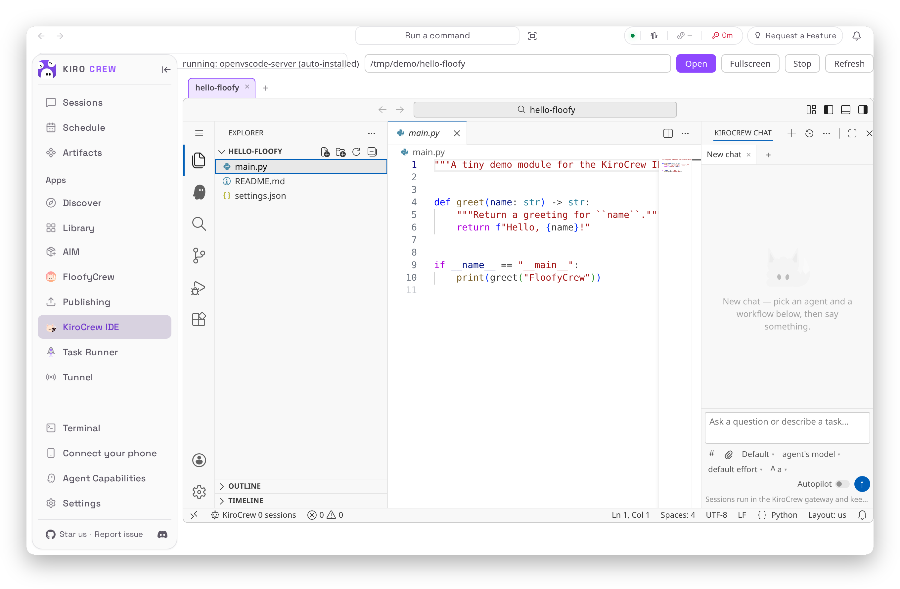
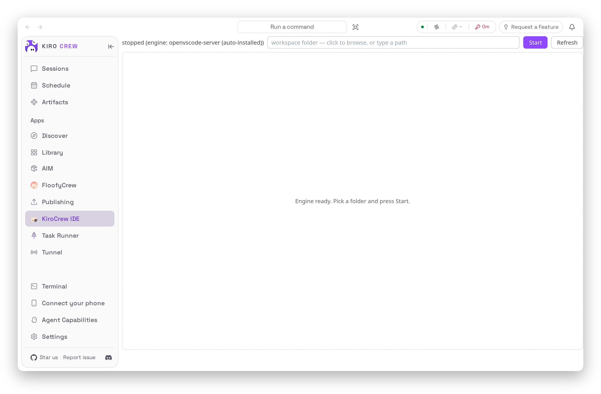

<a id="readme-top"></a>

<div align="center">
  <a href="https://github.com/floofycrew/kirocrew-ide">
    
  </a>
  <h1><b>KiroCrew IDE</b></h1>
  <p>
    A full VS Code workbench inside your <a href="https://github.com/kirodotdev/KiroCrew">KiroCrew</a> dashboard &mdash; with KiroCrew chat, durable sessions and the Kiro spec workflow in the editor. One port, no extra tunnel.
  </p>
  <p>
    <a href="https://github.com/floofycrew/kirocrew-ide/issues/new?labels=bug">Report a bug</a>
    &middot;
    <a href="https://github.com/floofycrew/kirocrew-ide/issues/new?labels=enhancement">Request a feature</a>
    &middot;
    <a href="https://github.com/floofycrew/FloofyCrew">FloofyCrew, the mod manager</a>
  </p>
  <p>
    <a href="https://github.com/floofycrew/kirocrew-ide/releases/latest"></a>
    <a href="https://github.com/floofycrew/kirocrew-ide/blob/main/LICENSE"></a>
    <a href="https://github.com/floofycrew/kirocrew-ide/stargazers"></a>
    <a href="https://github.com/floofycrew/kirocrew-ide/issues"></a>
  </p>
  <br>
  
</div>

<br>

<details>
  <summary><b>Table of contents</b></summary>
  <ol>
    <li><a href="#what-is-it">What is it?</a></li>
    <li><a href="#why-use-it">Why use it?</a></li>
    <li><a href="#install">Install</a></li>
    <li><a href="#a-tour">A tour</a></li>
    <li><a href="#everything-it-does">Everything it does</a></li>
    <li><a href="#parts">Parts</a></li>
    <li><a href="#requirements">Requirements</a></li>
    <li><a href="#install--develop">Install / develop</a></li>
    <li><a href="#config-keys-mod-config">Config keys</a></li>
    <li><a href="#one-port-only-remote-hosts">One port only</a></li>
    <li><a href="#tests">Tests</a></li>
    <li><a href="#license">License</a></li>
  </ol>
</details>

## What is it?

KiroCrew IDE is a [FloofyCrew](https://github.com/floofycrew/FloofyCrew) mod
that turns KiroCrew into your main IDE. It runs a VS Code web engine
(openvscode-server) as a loopback sidecar of the KiroCrew gateway, serves the
whole workbench **inside the dashboard, on the dashboard's own port**, and puts
KiroCrew into the workbench: chat with any crew agent, sessions that survive a
dropped ssh connection, tool approvals from the editor, and the Kiro spec
workflow (requirements &rarr; design &rarr; tasks &rarr; **Run all tasks**) over
`.kiro/specs`.

## Why use it?

- **One port** &mdash; the workbench is served same-origin at `/kirocrew-ide`;
  the port you already forward carries the IDE, nothing extra to tunnel.
- **KiroCrew inside** &mdash; chat tabs, per-project history, approvals and
  question cards in the editor; sessions run in the gateway, so closing the
  laptop loses nothing.
- **Kiro's spec workflow** &mdash; Specs, Steering, Skills and Agent Hooks views,
  **Run all tasks** on a `tasks.md`, a completeness donut per workspace.
- **Several workspaces, one engine** &mdash; a tab row like a browser's; idle
  workspaces sleep and wake in seconds.

Unofficial. Not affiliated with Kiro or the KiroCrew maintainers.

## Install

Needs [FloofyCrew](https://github.com/floofycrew/FloofyCrew) on the gateway
host. Then:

```bash
floofy install kirocrew-ide
```

or click *Install* on the dashboard's **FloofyCrew** page, restart the gateway
once (the same-origin route is added while it composes its router; the
FloofyCrew page has the button), and open **Apps &rarr; KiroCrew IDE**: pick a
folder, press **Start**. The first start offers to download the engine
(openvscode-server, MIT, ~100 MB) after your confirmation; an
`openvscode-server` or `code-server` already on PATH is used instead.

<div align="right">[<a href="#readme-top">back to top</a>]</div>

---

## A tour

**The App page** is where a workspace starts: a folder picker with recent
workspaces, Start/Stop, engine install, and the workbench docked right there
while the engine runs. **Fullscreen** raises it over the whole dashboard.

<div align="center">
  
</div>

**The workbench** is VS Code with KiroCrew in the secondary side bar: one
session per chat tab, every installed agent in the picker, approvals inline,
file paths as links into editor tabs. Out of the box the workbench follows the
dashboard's light or dark mode with the matching stock VS Code theme; pick any
other theme and it stays yours.

<div align="right">[<a href="#readme-top">back to top</a>]</div>

---

## Everything it does

- **KiroCrew IDE** in the Apps sidebar: a folder picker (recent workspaces +
  browse; its list opens over the docked workbench, not under it), Start/Stop,
  engine install, and the workbench **docked in the
  page** while the engine runs, with a **Fullscreen** button that raises it
  over the whole dashboard (not the OS fullscreen). It is one persistent
  layer either way: it stays warm while hidden or docked, so going back to
  KiroCrew, leaving the page and returning never reloads it. A bouncing
  FloofyCrew fox covers the workbench while it boots; the empty-editor
  watermark is the fox in grey.
- **Tag stacks** to move without leaving the IDE: in KiroCrew's own crew
  switcher the host's chip grows an attached **`IDE`** segment
  (`[host]IDE]`) while the IDE runs there, lit while it is fullscreen. The
  layer's title bar has ◁ KiroCrew, a host dropdown (the crew on screen as the
  trigger; the menu lists Local and every remote the desktop app knows, the
  current host marked "you are here" and returning to its dashboard, the
  others switching hosts through the desktop window exactly as KiroCrew's own
  bar does; colours follow the workbench's menu theme) with the same lit
  `IDE` segment joined to it (`[host ▾]IDE · folder ▾]`). Esc closes a menu,
  then leaves fullscreen like ◁ KiroCrew does — onto the App page's dock when
  that page is open, otherwise back to the dashboard. In a plain browser tab
  without a crew bar a standalone
  `<host> IDE` chip sits in the top bar.
- **Several workspaces on one host.** The `IDE` segment is a dropdown — the
  workspace manager: every folder open on the engine (the one on screen
  marked, a × to close it) and **Open a folder…**, a picker right in the menu
  (recent workspaces, then the engine-side directory listing) so another
  project opens without leaving fullscreen. One engine serves them all; each
  workspace is its own workbench document, created when first shown and kept
  warm, so switching never reloads anything. The App page mirrors this: Start
  reads **Open** while the engine runs and adds the folder, and a tab row sits
  on the workbench like a browser's (click to switch, × to close, **+** opens
  the folder picker). Closing the last one leaves the engine up with nothing
  open. Each warm workspace is a live workbench: on the client it is a full
  VS Code renderer (roughly 300–450 MB of browser memory each), and on the
  host it is its own extension host, file watcher and language servers
  (150–400 MB each, growing with the extensions a folder activates). So
  **inactive workspaces sleep**: a document that has been off screen (another
  workspace in front, or the IDE left for other dashboard pages) for 15
  minutes is unloaded, which frees both sides within a second. The workspace
  stays open; its tab shows ☾ and the menu row reads *asleep*; switching to
  it reconnects in a few seconds, with the workbench's own hot exit and
  terminal persistence covering the gap. The limit is the **Sleep inactive
  workspaces after** select at the bottom of the workspace menu (never, 5,
  15, 30, 60 min), a host-wide setting (`idle_unload_minutes`).
- **Task completeness per workspace.** A tiny donut and percentage sit at
  the workbench's top right, just left of its own layout controls (measured
  from the live title bar so they never overlap), in docked and fullscreen
  mode alike: the share of ticked boxes in the workspace's
  `.kiro/specs/*/tasks.md` files, every box counted (parent and sub-task,
  optional `*` ones too), the done share in the theme's chart green and the
  queued / in-progress share Kiro's orchestrator writes (`[~]` / `[-]`) in
  its chart blue. Several specs combine into the one figure; click it for
  the breakdown: the combined count, then a row per spec directory with its
  own donut, `done/total` and the live states. The workspace menu's rows and
  the App page's tabs carry the same mini donut per workspace, so every open
  folder's progress is one glance away. The hook counts the files on each
  status poll (re-read only when a file changes), so a tick the agent writes
  shows within seconds. Nothing is shown for a folder without spec tasks.
- **The bar keeps out of the workbench's way.** In fullscreen the layer's bar
  (`◁ KiroCrew | host ▾ | IDE · folder ▾`) ends where the workbench's own
  title-bar centre (the ← → arrows and the command centre) begins, measured
  from the live document and re-measured on resize. Under that budget the
  folder name is the piece that gives way: it is not ellipsised but faded at
  the cut edge, like KiroCrew's crew row. Rest the pointer on the chip and
  the name glides to its end (and back when you leave); a wheel or trackpad
  anywhere on the chip scrolls it by hand; the full path is in the tooltip
  and the menu.
- **Profiles follow you.** The web workbench keeps the profile list in the
  browser, per origin, so a profile imported in the desktop app used to be
  missing in a browser tab (or after the app's storage moved) while its data
  sat on the host. The mod now seeds every client's list from the engine's
  own record of the profiles that exist on disk.
- **KiroCrew Chat** in the IDE's secondary side bar (the built-in AI chat is
  turned off): tabs, one KiroCrew session per tab, per-project **History**
  (every session whose project is the open folder — created here or in the
  dashboard — reopens in a tab; most recent activity first, each row dated
  by its age), any installed agent, live streaming, paths
  as links into editor tabs, Approve/Reject and question cards inline. A chat
  pane that comes up blank is reloaded by the bridge itself (twice, 8 s apart)
  before it tells you; **KiroCrew: Reload chat view** (also in the view's ⋯
  menu) does the same by hand, and the **KiroCrew IDE** output channel says
  what happened. The composer's model/effort/Autopilot picks are yours alone:
  what a live session actually runs with is shown on its tab but never
  inherited by the next tab, and a model id the host's catalog has retired is
  dropped (with a note) instead of pinned on a new session.
- **KiroCrew** activity-bar views: *Specs* (`.kiro/specs/<name>/`, phase
  commands, ▶ Start task per row, ⏵⏵ Run all tasks per spec, Kiro's queued /
  in-progress / done marks), *Steering*, *Skills*, *Agent Hooks* — each showing
  the workspace's `.kiro/` and the global `~/.kiro/` tier, with a ＋ that
  scaffolds a new file or skill folder. The bridge is registered for **every
  VS Code profile** (application-scoped), so a profile you create or import
  keeps the chat and these views, and its activity bar gets KiroCrew in
  second place too.
- The model's reasoning renders the way KiroCrew's own transcript renders it:
  one collapsed **Thinking** block per thinking phase with a one-line live
  tail while it streams, **Thought process** once it goes quiet, the full text
  a click away; a tool call or the answer closes the block and later reasoning
  opens a new one.
- Sessions run in the gateway. Close the laptop, drop the tunnel, come back
  from the dashboard or your phone: same session, same transcript.

## Parts

| Part | Seam | What |
|---|---|---|
| `hook/` (python-hook, early) | gateway | engine supervisor + control API (`status` with per-workspace spec-task counts, `start` `stop` `workspaces/open` `workspaces/close` `engines` `engines/install` `browse`), the same-origin proxy at `/kirocrew-ide`, bridge-extension provisioning |
| `app/` (app) | App Kit | the **KiroCrew IDE** App page. `app/ui/art/icon.svg` is the App's face in the Apps sidebar and the store (manifest `iconPath`): the fox wearing a `</>` badge |
| `extension/` | the engine | the KiroCrew web extension (chat, sessions, approvals, specs), provisioned per start |
| `ui/page.mjs` (ui) | FloofyCrew App | engine status and settings; points at the App. `ui/icon.svg` is the mod's face in FloofyCrew's Mod pages and Installed mods (the same fox as the App page's loading splash) |

## Requirements

An IDE engine on the gateway host (not bundled — your choice, your license).
With none found, the App offers **Install engine**: it downloads an
openvscode-server release (MIT, ~100 MB) from GitHub into the mod's data
directory after your confirmation — the mod's only network use
(`network.hosts`: github.com, api.github.com, objects.githubusercontent.com).
Alternatives: `openvscode-server` or `code-server` on PATH, or
`engine.command` in the mod config.

The engine binds `127.0.0.1` only and, by default, runs without a connection
token (see `engine.token`); the dashboard's own session is what guards the
proxy.

**Kiro's own modes** (Spec, Quick Spec, Bug Fix, Plan as real agents) come
from the **kiro-spec-plan** mod, which this mod *recommends* rather than
requires: `floofy install kiro-spec-plan` (or the FloofyCrew page) adds its
four agents to `~/.kiro/agents`, and the chat's Agent picker then lists them
under "Kiro modes". Without it the same four names appear under "Workflows
(prompt-guided)" — a prompt frame injected on your default agent, not Kiro's
procedure — headed by a row that says so and hands you the install command.

**Running tasks** works the way Kiro's IDE does. On a `tasks.md` the
editor's primary action is **Run all tasks** (or **Resume tasks** once some
are ticked): one click, one durable session, every remaining required task
back to back — no "run task N" per task. Each open row has its own **Start
task** for a single task; queued (`[~]`) and in-progress (`[-]`) rows show
their state instead. Both run with Autopilot on (`kirocrew.specAutopilot`),
as Kiro does, so the run is not interrupted by tool approvals. With
kiro-spec-plan installed the request sent is the very text Kiro's IDE sends
its engine ("Run all tasks for this spec." with the resume suffix; "Execute
the following task …" with Kiro's `<task>` block), so the engine's own Task
Orchestrator queues the tasks, runs them through its task-execution sub-agent
and writes `[~]` / `[-]` / `[x]` back into `tasks.md` as it goes. Without it a
paraphrase carrying the same task block asks your crew agent for the same
non-stop loop. Optional tasks (`- [ ]* …`) are skipped by Run all; the spec's
context menu has **Run all required and optional tasks**, which removes the
`*` marks first (Kiro's "make all required").

## Install / develop

```bash
floofy install kirocrew-ide          # from the FloofyCrew registry, or the Install box on the FloofyCrew page
# restart the gateway once: the same-origin proxy is added while it composes its router
# then Apps -> KiroCrew IDE -> pick a folder -> Start
```

From a checkout of this repository, `floofy dev <checkout> --follow` runs the
mod live against your dashboard.

Design, the display-strategy analysis, the bridge architecture and the "why a
mod, not an App" proof: [DESIGN.md](DESIGN.md).

## Config keys (mod config)

| Key | Meaning |
|---|---|
| `default_folder` | folder the picker starts in / Start opens when none is given |
| `idle_unload_minutes` | minutes an off-screen workspace document stays warm before it is unloaded (default 15, `0` never); set from the workspace menu's footer, route `POST settings/idle-unload {"minutes"}` |
| `engine.command` | full engine command template (`{port}` `{token}` `{folder}` `{auth}` `{basepath}` `{extensions}`) |
| `engine.version` | pin the auto-installed openvscode-server version (default: latest release) |
| `engine.port` | pin the engine's loopback port (default: first free of 35476–35485) |
| `engine.token` | `true` runs the engine with a connection token; breaks embedding (its cookie is `SameSite=Lax`) |

IDE-side settings (VS Code settings, `kirocrew.*`): `agent` (default agent
for chats and spec phases), `specAgent` (agent that executes tasks),
`specAutopilot` (task runs approve their tools, default on),
`folderName` (dashboard folder, default "KiroCrew IDE"), `notifyApprovals`.

## One port only (remote hosts)

The workbench is served same-origin at `/kirocrew-ide` on the dashboard, so the
port you already forward carries the IDE — nothing extra to tunnel. The route
is added while the gateway composes its router, hence the one restart after
installing. Should the early shim be unavailable, the mod falls back to the
engine's own loopback port and the App tells you the `ssh -L` line.

## Tests

```
python tests/<name>_test.py            # hook units (stub floofy module, no host code)
node --test tests/extension_unit.test.mjs
tests/e2e/probe_extension.py <url>     # headless: the extension activates in the workbench
tests/e2e/probe_profile.py <url> <profile> <udd>   # headless: bridge + seeded order in a non-default profile
tests/e2e/probe_hosts.py               # headless, self-contained: the layer (host switcher, modes, workspaces) in stub realms
tests/e2e/probe_chat_webview.py        # headless, self-contained: the chat webview's transcript (the thinking block) driven with the extension's own messages
tests/e2e/chat_roundtrip.py <url>      # headless: a message round-trips through a gateway session
```

The e2e scripts drive a workbench URL; through the dashboard (with a session)
the chat round-trip is real, directly on the engine port only activation is.

## License

MIT. The IDE engine you install has its own license (openvscode-server: MIT;
code-server: MIT; Microsoft's VS Code builds/marketplace have their own terms
— this mod ships none of them).
